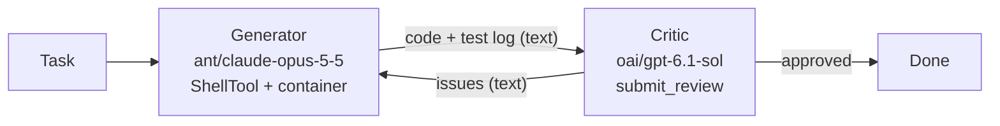
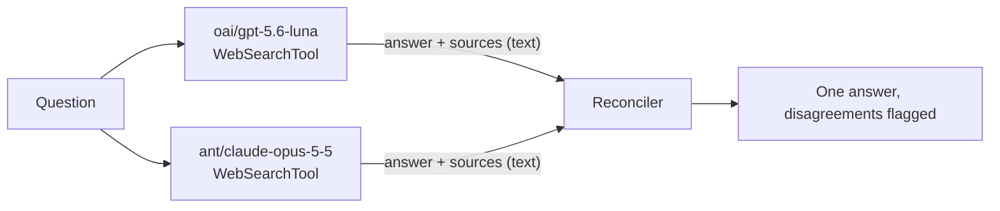

# Provider tools

Provider tools are tools whose schema and implementation are defined by the model provider. You could write shell, computer use or web search tools yourself as [function tools](tool-calling.md), but they are so central to agents that OpenAI and Anthropic ship standard versions of them. Their models are trained on these tools and already know their schemas, so they use them well and quickly. You turn them on by adding them to the request, and the native APIs handle the rest.

Provider tools come in two kinds, depending on who runs them:

- **Client-executed** tools are defined by the provider, but your code runs them. Each call comes back as an output item, your code carries it out, and you append a result to the history, as you do for a [function tool](tool-calling.md#handling-function-calls). Computer use works this way on both providers.
- **Server-side** tools run entirely on the provider's servers. The call comes back in the response with its result already filled in, so you send nothing back. Web search is the typical example.

Tessaract gives each provider tool one canonical type that works on both providers, so an agent can use OpenAI's and Anthropic's web search, shell or computer use tools without writing them twice. The provider's native tool is still what runs, so you keep its native behavior and performance.

## One tool, local or hosted

Some provider tools support both kinds. OpenAI's `shell` tool runs commands on your machine, or in a container OpenAI hosts. Anthropic splits the same job into two tools: `bash` runs on your machine, and code execution runs in a container Anthropic hosts. In Tessaract both are a `ShellTool`, and you switch between local and hosted execution by changing one argument:

```python
from tessaract import ContainerEnvironment, ShellTool

ShellTool()                                          # client-executed: OpenAI shell (local) or Anthropic bash
ShellTool(environment=ContainerEnvironment())        # server-side: OpenAI hosted shell or Anthropic code execution
```

The rest of your code stays the same. Each `shell_call` says where it ran in `executed_by`, so one loop handles both:

```python
for call in (item for item in response.output if item.type == "shell_call"):
    if call.executed_by == "provider":       # server-side: the output is already in call.output
        continue
    history.append(run_locally(call))        # client-executed: run it and send a ShellToolResult
```

## Tools at a glance

| Tool | Kind | Call item | You send back |
| --- | --- | --- | --- |
| `WebSearchTool` | server-side | `WebSearchCallOutputItem` (`"web_search_call"`) | nothing |
| `ShellTool(environment=ContainerEnvironment())` | server-side | `ShellCallOutputItem` with `executed_by="provider"` | nothing |
| `ShellTool()` (a local environment) | client-executed | `ShellCallOutputItem` with `executed_by="client"` | `ShellToolResult` |
| `ComputerUseTool` | client-executed | `ComputerCallOutputItem` (`"computer_call"`) | `ComputerToolResult` |
| `ProviderTool` | either, depending on the native tool | `ProviderOutputItem`, or a canonical item | nothing, or a `ProviderToolResult` |
| `FunctionTool` | not a provider tool: you define and run it | `FunctionCallOutputItem` (`"function_call"`) | `FunctionToolResult` |

All of them go in the same `tools=` list, and one request can mix both kinds. Whatever the kind, append all of `response.output` to the history: server-side calls replay unchanged, so the model can see its earlier searches and commands.

The rest of this page builds complete agents with these tools. The fields and per-provider mappings are in Tool calling, under [Server tools](tool-calling.md#server-tools) and [Client-executed provider tools](tool-calling.md#client-executed-provider-tools). Each example is also a runnable script in [`examples/`](https://github.com/jenniferumoke/tessaract/tree/main/examples).

| Example | Kind | Provider |
| --- | --- | --- |
| [Research agent](#research-agent-openai) | server-side web search plus a function tool | OpenAI |
| [Data analyst in a container](#data-analyst-in-a-container-anthropic) | server-side shell | Anthropic |
| [Computer use agent](#computer-use-agent-openai) | client-executed computer use | OpenAI |
| [Generator and critic](#generator-and-critic) | server-side shell, then a function tool on another provider | Anthropic and OpenAI |
| [Parallel fan-out and compare](#parallel-fan-out-and-compare) | server-side web search on both providers | Anthropic and OpenAI |

## Research agent (OpenAI)

OpenAI runs the web searches. Your code runs `save_finding`, a function tool the model calls for every fact it relies on. The loop is the same as a function-calling agent: the searches simply need no results.

```python
from tessaract import FunctionTool, FunctionToolResult, InputSchema, OpenAIProvider, Property
from tessaract import ReasoningOptions, Tessaract, UserMessage, WebSearchTool

client = Tessaract(providers={"oai": OpenAIProvider()})

tools = [
    WebSearchTool(provider_options={"search_context_size": "high"}),   # OpenAI runs it
    FunctionTool(                                                       # your code runs it
        name="save_finding",
        description="Save one fact for the final report, with the URL of the page it came from.",
        input_schema=InputSchema(
            properties={
                "claim": Property(type="string", description="The fact, in one sentence."),
                "url": Property(type="string", description="The page the fact came from."),
            },
            required=["claim", "url"],
            additionalProperties=False,
        ),
    ),
]

history = [UserMessage(content="How do heat pumps perform below -20C?")]
findings = []

while True:
    response = client.send(
        model="oai/gpt-5.6-luna",
        input=history,
        tools=tools,
        instructions="Search the web, call save_finding for every fact you use, then write a cited report.",
        reasoning=ReasoningOptions(effort="medium"),
    )
    history.extend(response.output)                  # searches included

    for item in response.output:
        if item.type == "web_search_call":           # already ran; nothing to send back
            print(item.action, item.queries or item.url, len(item.sources))

    calls = [item for item in response.output if item.type == "function_call"]
    if not calls:
        break

    for call in calls:
        findings.append(call.arguments)
        history.append(FunctionToolResult(call_id=call.call_id, result="saved"))

print(response.output_text)
for item in response.output:
    if item.type == "assistant_message":
        for part in item.content:
            for citation in part.annotations:
                print(citation.title, citation.source)
```

Things to know:

- OpenAI can also browse a result. Those calls have `action="open_page"` or `"find_in_page"` and a `url`, but no `queries`.
- OpenAI returns source URLs without titles, so `citation.title` can be `None`.
- `response.usage.server_tool_requests` counts the searches, e.g. `{"web_search": 3}`.
- To search only sites you trust, pass `WebSearchTool(allowed_domains=["energy.gov", "iea.org"])`.

Runnable version: [`examples/research_agent.py`](https://github.com/jenniferumoke/tessaract/blob/main/examples/research_agent.py).

## Data analyst in a container (Anthropic)

With a `ContainerEnvironment`, Claude runs Python in Anthropic's code execution container. You upload a CSV with the Files API, copy it into a new container with `file_ids`, and keep using that container for follow-up questions with `response.container_id`.

```python
from tessaract import AnthropicProvider, ContainerEnvironment, ShellTool, Tessaract, UserMessage

provider = AnthropicProvider()
client = Tessaract(providers={"ant": provider})

with open("sales.csv", "rb") as f:
    uploaded = provider.client.files.upload(file=("sales.csv", f, "text/csv"))

history = []
environment = ContainerEnvironment(file_ids=[uploaded.id])     # a new container with the CSV in it

for question in [
    "Which region grew fastest month over month? Make a line chart of revenue by region.",
    "Now compare the average order value per product, and chart it.",
]:
    history.append(UserMessage(content=question))

    while True:
        response = client.send(
            model="ant/claude-opus-5-5",
            input=history,
            tools=[ShellTool(environment=environment)],
            instructions="You are a data analyst. Use pandas. Save every chart as a PNG file.",
        )
        history.extend(response.output)

        for call in (item for item in response.output if item.type == "shell_call"):
            print(call.executed_by, call.commands, [output.exit_code for output in call.output])
            for file_id in call.file_ids:            # files the command left, e.g. charts
                name = provider.client.files.retrieve_metadata(file_id).filename
                provider.client.files.download(file_id).write_to_file(name)

        environment = ContainerEnvironment(container_id=response.container_id)
        if response.incomplete_reason != "paused":
            break

    print(response.output_text)
```

Things to know:

- The calls have `executed_by="provider"` and their `output` already filled in. You never send a `ShellToolResult` for them.
- A long code execution turn can pause (`incomplete_reason == "paused"`). Keep the output in the history and send it again, in the same container, to let the model continue.
- `provider.client` is the native Anthropic SDK client, which you use for Files API calls Tessaract doesn't wrap.
- Anthropic containers have no network access, so `pip install` doesn't work. pandas and matplotlib are preinstalled.
- The same code runs on OpenAI's hosted shell when you change the model to `oai/...`. Upload the file with OpenAI's Files API, and download output files from the container instead of reading `file_ids`. See [Provider-managed shell](tool-calling.md#provider-managed-shell).

Runnable version, with a generated sample CSV: [`examples/data_analyst.py`](https://github.com/jenniferumoke/tessaract/blob/main/examples/data_analyst.py).

## Computer use agent (OpenAI)

`ComputerUseTool` is client-executed. The model sends actions, your code runs them on a screen it controls (here, a [Playwright](https://playwright.dev/python/) browser), and every result carries a screenshot so the model can see what happened.

```python
from playwright.sync_api import sync_playwright

from tessaract import ComputerToolResult, ComputerUseTool, OpenAIProvider, Tessaract, UserMessage

client = Tessaract(providers={"oai": OpenAIProvider()})

with sync_playwright() as playwright:
    page = playwright.chromium.launch(headless=False).new_page(viewport={"width": 1280, "height": 800})
    page.goto("https://news.ycombinator.com")

    history = [UserMessage(content="The browser is open on Hacker News. What are the top three stories?")]

    for _ in range(30):
        response = client.send(model="oai/gpt-5.6-luna", input=history, tools=[ComputerUseTool()])
        history.extend(response.output)

        calls = [item for item in response.output if item.type == "computer_call"]
        if not calls:
            print(response.output_text)
            break

        for call in calls:
            if call.safety_checks and not confirmed_by_a_person(call.safety_checks):
                raise SystemExit("Stopped at a safety check.")

            for action in call.actions:              # OpenAI can batch several actions in one call
                run_action(page, action)             # click, type, keypress, scroll, ... (below)

            history.append(ComputerToolResult(
                call_id=call.call_id,
                screenshot=page.screenshot(),        # OpenAI needs one in every result
                acknowledged_safety_checks=call.safety_checks,
            ))
```

`run_action` maps the canonical actions in `tessaract.types.computer_actions` onto Playwright:

```python
def run_action(page, action):
    match action.type:
        case "click":
            page.mouse.click(action.x, action.y, button=action.button, click_count=action.clicks)
        case "type":
            page.keyboard.type(action.text)
        case "keypress":                             # OpenAI sends "CTRL", "ENTER", ...
            page.keyboard.press("+".join(PLAYWRIGHT_KEYS.get(k.upper(), k) for k in action.keys))
        case "scroll":                               # OpenAI scrolls in pixels
            page.mouse.move(action.x, action.y)
            page.mouse.wheel(action.dx, action.dy)
        case "wait":
            page.wait_for_timeout((action.duration or 1) * 1000)
        case "screenshot":
            pass                                     # every result carries one anyway
```

Things to know:

- OpenAI puts one or more actions in a call. Run them all, then send **one** result with a screenshot.
- OpenAI has no error flag on computer results; `is_error=True` raises `UnsupportedToolOptionError`. When an action fails, send a screenshot of the current screen and let the model see what went wrong.
- A call can carry `safety_checks`, for example when the page looks like it is trying to trick the model. Have a person confirm them, then pass them back in `acknowledged_safety_checks`.
- Coordinates are in the pixel space of your screenshots, so keep the viewport size fixed.
- The model controls a real browser. Run it somewhere it can't do damage, cap the number of steps, and stop before anything irreversible such as a purchase.
- On Anthropic, the same tool sends one action per call, and every call needs its own result. See [Computer use](tool-calling.md#computer-use).

Runnable version, with modifier keys, drags and a full key map: [`examples/computer_use_agent.py`](https://github.com/jenniferumoke/tessaract/blob/main/examples/computer_use_agent.py).

## Multi-provider workflows

One `Tessaract` client can hold several providers, and each request goes to the provider named by its model prefix. That lets a workflow use each provider for what it does best:

```python
from tessaract import AnthropicProvider, OpenAIProvider, Tessaract

client = Tessaract(providers={"ant": AnthropicProvider(), "oai": OpenAIProvider()})
```

!!! warning "Hand off text, not history"
    Output items replay from their native form (`.raw`), so items from one provider can't be sent to another: an Anthropic `web_search_call`, `shell_call`, `reasoning` or `function_call` item isn't valid in an OpenAI request. Keep one history per provider, and pass work between them as text: `response.output_text`, a `UserMessage`, or text you build from the canonical fields (`commands`, `output`, `sources`, `annotations`). `AssistantMessage` items are rebuilt from their text, so they also carry over.

    Tool definitions do carry over. The same `WebSearchTool` or `ShellTool` works on both providers, except a `ProviderTool`, which is written for one provider.

### Generator and critic

Claude writes code and tests it in a code execution container. GPT reviews the code and the test run, and returns its verdict through a function tool. The loop repeats until the critic approves.



The critic returns a structured verdict through a forced function call. You read the arguments and never send a result:

```python
submit_review = FunctionTool(
    name="submit_review",
    description="Submit the review verdict.",
    input_schema=InputSchema(
        properties={
            "approved": Property(type="boolean", description="True if the code can be merged as is."),
            "issues": Property(type="array", items=Property(type="string"), description="What must change."),
        },
        required=["approved", "issues"],
        additionalProperties=False,
    ),
)

def review(code: str, test_log: str) -> dict:
    response = client.send(
        model="oai/gpt-6.1-sol",
        input=f"Task:\n{TASK}\n\nCode:\n```python\n{code}\n```\n\nTest run:\n{test_log}",
        tools=[submit_review],
        instructions="You are a strict code reviewer. Approve only code you would merge.",
        request_options={"tool_choice": {"type": "function", "name": "submit_review"}},
    )
    return next(item for item in response.output if item.type == "function_call").arguments
```

The generator keeps its full history and its container across rounds. The critic only sees text built from the generator's output: the final code block, and the commands its container ran with their output:

```python
history = [UserMessage(content=TASK)]
container_id = None

for round_number in range(1, 5):
    response = client.send(
        model="ant/claude-opus-5-5",
        input=history,
        tools=[ShellTool(environment=ContainerEnvironment(container_id=container_id))],
        instructions="Test your code in the container. End with the final module in one ```python block.",
    )
    history.extend(response.output)
    container_id = response.container_id

    code = re.findall(r"```python\n(.*?)```", response.output_text, re.DOTALL)[-1]
    test_log = "\n".join(
        f"$ {command}\n{output.stdout}{output.stderr}(exit {output.exit_code})"
        for call in response.output if call.type == "shell_call"
        for command, output in zip(call.commands, call.output)
    )

    verdict = review(code, test_log)
    if verdict["approved"]:
        break
    history.append(UserMessage(content="A reviewer asked for these changes:\n- " + "\n- ".join(verdict["issues"])))
```

Using two providers here means the reviewer doesn't share the generator's blind spots. Swap the prefixes to make OpenAI the generator: `ShellTool(environment=ContainerEnvironment())` runs in OpenAI's hosted shell without other changes.

Runnable version, which also handles paused turns: [`examples/generator_critic.py`](https://github.com/jenniferumoke/tessaract/blob/main/examples/generator_critic.py).

### Parallel fan-out and compare

Ask both providers the same question with web search, in parallel. Each runs its own searches, so the answers can rest on different sources. A third call gets both answers and their sources as text, and writes one answer that says where they agree and where they don't.



```python
from concurrent.futures import ThreadPoolExecutor

def ask(model: str) -> str:
    response = client.send(model=model, input=QUESTION, tools=[WebSearchTool()])

    sources = {}
    for item in response.output:
        if item.type == "web_search_call":
            sources.update({source.url: source.title or "" for source in item.sources})
    listed = "\n".join(f"- {title} {url}" for url, title in sources.items())

    return f"## Answer from {model}\n\n{response.output_text}\n\nSources:\n{listed}"

with ThreadPoolExecutor() as pool:
    answers = list(pool.map(ask, ["oai/gpt-5.6-luna", "ant/claude-opus-5-5"]))

response = client.send(
    model="ant/claude-opus-5-5",
    input=f"Question: {QUESTION}\n\n" + "\n\n".join(answers),
    instructions="Write one answer. Say where the two answers agree, flag every disagreement "
                 "with the sources on each side, and cite URLs.",
)
print(response.output_text)
```

Things to know:

- `client.send` is synchronous, so the example uses threads to send both requests at once.
- The same `WebSearchTool()` works on both providers. Options only one provider supports, such as `max_uses` (Anthropic only), raise `UnsupportedToolOptionError` on the other, so leave them out of a tool you fan out.
- On Anthropic, a long search turn can pause. The runnable version resends paused turns and also collects the citation annotations as sources.

Runnable version: [`examples/fan_out_compare.py`](https://github.com/jenniferumoke/tessaract/blob/main/examples/fan_out_compare.py).

## Running the examples

```bash
export OPENAI_API_KEY="your-openai-key"
export ANTHROPIC_API_KEY="your-anthropic-key"

uv run --extra openai python examples/research_agent.py "How do heat pumps perform below -20C?"
uv run --extra anthropic python examples/data_analyst.py            # or: ... data_analyst.py sales.csv
uv run --extra openai --with playwright playwright install chromium
uv run --extra openai --with playwright python examples/computer_use_agent.py
uv run --extra openai --extra anthropic python examples/generator_critic.py
uv run --extra openai --extra anthropic python examples/fan_out_compare.py "Your question"
```

Set `TESSARACT_MODEL` to change the model in the single-provider examples, and `GENERATOR_MODEL`, `CRITIC_MODEL` or `RECONCILER_MODEL` in the multi-provider ones.
